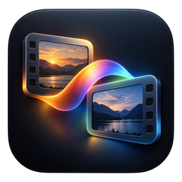

# LookBridge

**CDLs and reference stills, together in DaVinci Resolve Studio.**

LookBridge packages Atom Film Lab's CDL Auto Apply and Reference Still Auto Overlay tools into one Resolve launcher, with a native Mac installer and optional automatic updates.

[Download for Mac](https://github.com/untitledca/LookBridge/releases/latest) · [Atom Film Lab apps](https://www.atomfilmlab.com/apps)

## What it does

- Matches ASC CDL files to timeline source filenames and applies them to a dedicated `CDL` node after an audit and confirmation.
- Matches reference stills to camera originals and maps their captured source timecode to the timeline.
- Places one-frame references on managed tracks, with A/B, Difference, opacity, previous/next grab navigation, and PSNR comparison.
- Opens both workflows from one LookBridge window inside Resolve.
- Provides small, optional $5 / $10 / $25 QuickBooks support links. The tools remain free; no payment unlocks features.
- Installs the Resolve scripts and checks for signed updates through GitHub using Sparkle. Automatic checks and installation are opt-in.

The original audit and confirmation steps remain in place. LookBridge does not force-save projects. Reference tracks start disabled. Keep a project backup and review results before saving or rendering.

## Requirements

- macOS 12 or later, on Apple Silicon or Intel. Resolve itself may require a newer macOS version.
- DaVinci Resolve **Studio**, with scripting and Fusion UI Manager available. The bundled reference workflow was developed for Resolve 21.0.4; the LookBridge popup was also constructed successfully in Studio 21.1.0.14. Complete grade/reference operations have not been revalidated on every Resolve version.
- Python 3 scripting support in Resolve. Current Resolve includes its scripting runtimes; older installations may need their supported Python runtime.
- An English Resolve interface and macOS Accessibility/Automation permission for automatically creating CDL nodes. Applying to an existing `CDL` node does not require automatic node creation.

Blackmagic's current UI Manager is a Studio feature. See the [Blackmagic staff explanation](https://forum.blackmagicdesign.com/viewtopic.php?p=1123901&t=216545).

## Install

1. Download and open `LookBridge-1.0.0-universal.dmg`.
2. Fully quit Resolve, open **LookBridge**, and choose **Install LookBridge**. The app installs its manager in your Applications folder and the bundled scripts for your Mac account.
3. Open Resolve so its script menu refreshes.
4. Choose **Workspace → Scripts → LookBridge → LookBridge**.
5. Choose **CDL Auto Apply** or **Reference Still Auto Overlay**. Select the folder and review the audit before applying or building.

This release is ad-hoc signed and is **not Apple-notarized**. If macOS blocks first launch, use the explicit **Open Anyway** option in System Settings → Privacy & Security after opening the downloaded app. Sparkle's signed update feed is a separate authenticity mechanism; it is not Apple notarization.

The installer keeps backup copies of files it replaces. It does not remove your source footage, grades, still images, or the reference sequence cache. Existing standalone scripts are preserved; you can keep using them or use the new LookBridge submenu.

## Updates and support

Use **Check for Updates** in the Mac app or the small link in the Resolve popup. The Resolve link opens the installed LookBridge manager. Enable automatic checks and installation in the manager if desired; the manager must be running to check automatically.

Updates use a dedicated LookBridge Ed25519 key, a signed feed, and a signed installer archive. After an app update, new script payloads wait until Resolve is closed before the manager installs them. Open Resolve again to load the new scripts. Optional support links open the existing Atom Film Lab QuickBooks checkout in your browser; nothing is charged automatically.

## Detailed workflow documentation

- [CDL matching, node behavior, and command-line options](docs/originals/cdl-README.md)
- [Reference mapping, A/B review, and PSNR behavior](docs/originals/reference-README.md)

These two documents are preserved from the input script packages. Their standalone `install.command` instructions and statements about prior installation describe those original packages; use the LookBridge installer instructions above for this app.

## Development

Source scripts live in `scripts/`; the native macOS installer and updater are in `macos/`. Build and verification commands are documented in [Publishing updates](docs/Publishing-updates.md). The source repository excludes build products and signing secrets.

LookBridge is an independent Atom Film Lab utility and is not affiliated with Blackmagic Design.
